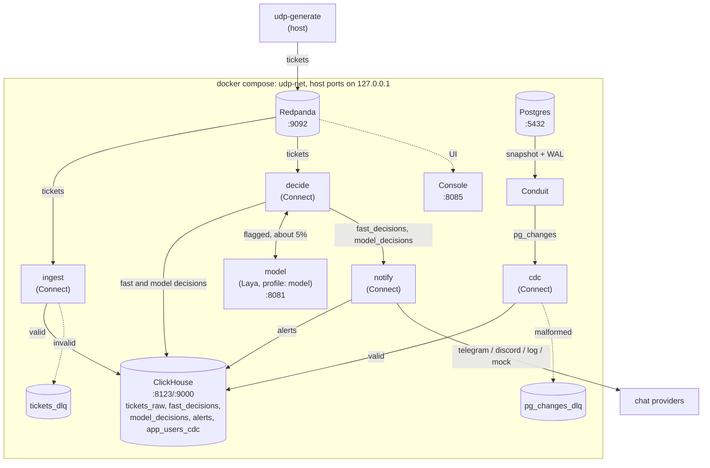

# Ultimate Data Pipeline — Realtime

A real-time pipeline for app-user tickets. A deterministic rule table classifies
each ticket. Tickets that the rules cannot classify go to a Laya decision model.
Decisions land in ClickHouse. Qualifying decisions become alerts in Telegram,
Discord, or a local sink. Postgres changes reach ClickHouse through a Conduit
CDC bus.

## Architecture



- **ingest** reads topic `tickets` and writes `udp.tickets_raw`. A malformed
  ticket or a ticket with a missing required field goes to `tickets_dlq`.
  The pipeline does not drop it silently.

- **decide** runs the cascade. Six keyword rules classify about 95% of tickets
  in process. The remaining tickets POST the `/v1/systemone` contract to the
  Laya model. Every flagged ticket produces a row in `udp.model_decisions`: a
  real verdict or a degraded fallback.

- **notify** checks a decision against `THRESHOLD_SCAM_P` and
  `THRESHOLD_ESCALATE_P`. It drops a duplicate `decision_id` with a point query
  against `udp.alerts`. It limits delivery to 10 alerts per minute. Extra alerts
  land with `suppressed=true`. Delivery goes to Telegram, Discord, the log, or
  the in-network mock receiver.

- **conduit + cdc** copy Postgres `app_users` changes through logical
  replication to topic `pg_changes`. The `cdc` pipeline writes the change log
  to `udp.app_users_cdc`. A malformed record goes to `pg_changes_dlq`.

## Quickstart

Prerequisites: Docker with Compose v2 and `uv`.

```bash
cp .env.example .env
make sync
make up-mock
```

`make up-mock` starts the full stack with a mock decision server and a mock
alert receiver. It needs no GPU. To run the real Laya model, install the model
runtime (see [docs/model-runtime.md](docs/model-runtime.md)) and use
`make up-model` instead.

Send tickets:

```bash
uv run udp-generate --count 1000 --rate 100
```

Open the Redpanda Console at <http://127.0.0.1:8085>. In mock mode, alerts go
to the in-network mock receiver. The base stack and the real-model stack use
`log` by default, so alerts appear in the notify container log. Set
`NOTIFY_PROVIDER` in `.env` to send them to Telegram or Discord.

## Configuration

Copy `.env.example` to `.env`. Change the development defaults before you
deploy the stack on a shared host. Never commit `.env`.

| group | variables | purpose |
|---|---|---|
| Kafka | `REDPANDA_BOOTSTRAP` | bootstrap servers for host tools |
| ClickHouse | `CLICKHOUSE_USER`, `CLICKHOUSE_PASSWORD`, `CLICKHOUSE_DB` | storage |
| Postgres | `POSTGRES_*`, `POSTGRES_DSN` | CDC source; `POSTGRES_DSN` overrides the parts |
| model | `MODEL_ENDPOINT_URL` | decision endpoint, default in-network |
| thresholds | `THRESHOLD_SCAM_P`, `THRESHOLD_ESCALATE_P` | alert triggers |
| notifier | `NOTIFY_PROVIDER`, `TELEGRAM_BOT_TOKEN`, `TELEGRAM_CHAT_ID`, `DISCORD_WEBHOOK_URL`, `ALERT_RATE_LIMIT_PER_MIN` | delivery |
| ports | `REDPANDA_CONSOLE_PORT`, `POSTGRES_PORT` | host ports |
| runtime | `HF_HOME` | model weights cache |

Wire contracts are in [docs/schemas.md](docs/schemas.md). Component details and
failure behavior are in [docs/architecture.md](docs/architecture.md).

## Tests

```bash
make lint
make typecheck
make test
```

The integration harness checks the running stack:

```bash
bash tests/integration/smoke.sh          # mock, no GPU
bash tests/integration/smoke.sh --model  # real model
make load-test                           # chaos and load run
```

`make demo` runs the real-model smoke test. It starts from a clean slate and
sends 2000 tickets at 100 events/s. It runs a scam burst and checks counts, the
fast/model split, degraded rows, the DLQ, alert joins, and CDC.

## Status

The measured acceptance results are in [docs/acceptance.md](docs/acceptance.md).
Key results:

- 60 000 tickets at 100 events/s: no end-to-end loss. The fast/model split was
  95.02/4.98. All four consumer groups drained.

- Fast path p95 was 81 ms. Model path p95 was 467 ms.

- A chaos restart kept alert dedupe and the 10-per-minute delivery limit.

## Scope

This repository covers the realtime path only. Batch analytics is a separate
repo. The contract is in [docs/v2-batch.md](docs/v2-batch.md).
