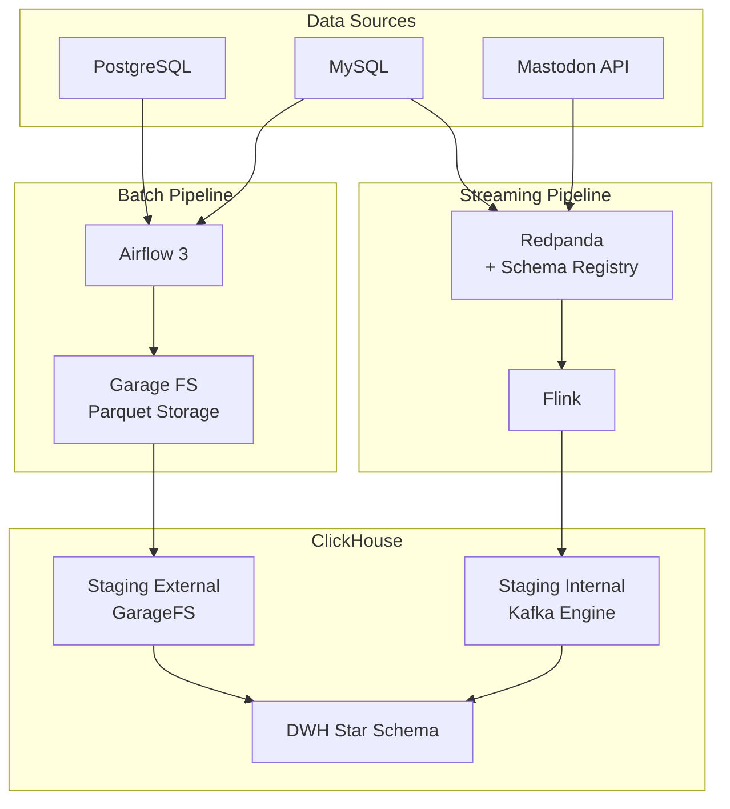

# Ultimate Data Pipeline

Unified batch and streaming data pipeline with MySQL/PostgreSQL sources, Mastodon integration, and ClickHouse analytics.

Status note:
- Streaming runtime is available now via `docker-compose.streaming.yaml` at repository root.
- Batch runtime is available via `docker-compose.batch.yaml` at repository root.

## Architecture Overview



## Runtime Entrypoints

- Streaming: `docker compose -f docker-compose.streaming.yaml up -d`
- Batch: `docker compose -f docker-compose.batch.yaml up -d`

Legacy path migration:
- The previous `real_time_pipeline/docker-compose.yaml` entrypoint has been replaced by `docker-compose.streaming.yaml` in the repository root.

## Directory Structure

```
ultimate-data-pipeline/
├── batch/                     # Batch pipeline (Airflow)
│   ├── dags/
│   └── src/
├── streaming/                 # Streaming pipeline (Flink + Redpanda)
│   ├── connectors/
│   └── flink/
├── src/
│   └── clickhouse/          # Schema definitions
├── config/                   # TOML configuration
├── docker-compose.streaming.yaml
└── tests/
```

## Technology Stack

| Component | Technology |
|-----------|------------|
| Language | Python 3.12+ |
| Package Manager | uv |
| Code Quality | Ruff, Pyrefly |
| Container | Docker Compose |
| Orchestration | Airflow 3 |
| Message Broker | Redpanda (Avro) |
| Stream Processing | Apache Flink |
| CDC | Redpanda Connect |
| OLAP | ClickHouse |
| Object Storage | Garage FS |

## Quick Start

### Prerequisites

- Docker & Docker Compose
- Python 3.12+
- uv

### Environment Setup

Create `.env` in the repository root with your local credentials and endpoints.

### Start Streaming Pipeline

```bash
docker compose -f docker-compose.streaming.yaml up -d
```

### Start Batch Pipeline

```bash
docker compose -f docker-compose.batch.yaml up -d
```

## Configuration

All configuration via TOML files in `config/` directory:

- `config.base.toml` - Base settings
- `config.dev.toml` - Development overrides
- `config.prod.toml` - Production settings
- `connections.toml` - Database connections

## Best Practices

### Code Quality

- Use Ruff for linting and formatting
- Use Pyrefly for type checking
- Full type annotations required
- OOP principles with composition over inheritance

### Memory Management

- Maximum 8GB RAM for personal PC
- Batch mode: server-side cursors, chunked processing
- Streaming mode: micro-batch processing
- Run batch and streaming separately (independent compose entrypoints)

### Data Modeling

- Staging: Raw data with minimal transformation
- DWH: Star schema with `dim_user`, `dim_product`, `dim_payment_method`, `dim_date`, and `fact_transactions`
- External tables for GarageFS Parquet files
- Internal tables for Kafka engine streams

### Security

- PII detection and redaction for Mastodon data
- Hash or mask sensitive fields
- TLS for all connections
- Secrets via `.env` file (local development)

### Schema Evolution

- Avro schema with Schema Registry
- Backward compatible schema changes
- Version tracking for schema history

## Development

### Install Dependencies

```bash
uv sync
```

Install with development tools:

```bash
uv sync --all-extras
```

### Run Tests

```bash
pytest tests/
```

### Lint & Type Check

```bash
ruff check .
ruff format .
pyrefly
```

### Pre-commit

```bash
uvx prek install
uvx prek run --all-files
```

## Documentation

- [Detailed Design](detailed-design.md)
- [Streaming Pipeline](streaming/README.md)
- [Batch Pipeline](batch/README.md)

## License

MIT
