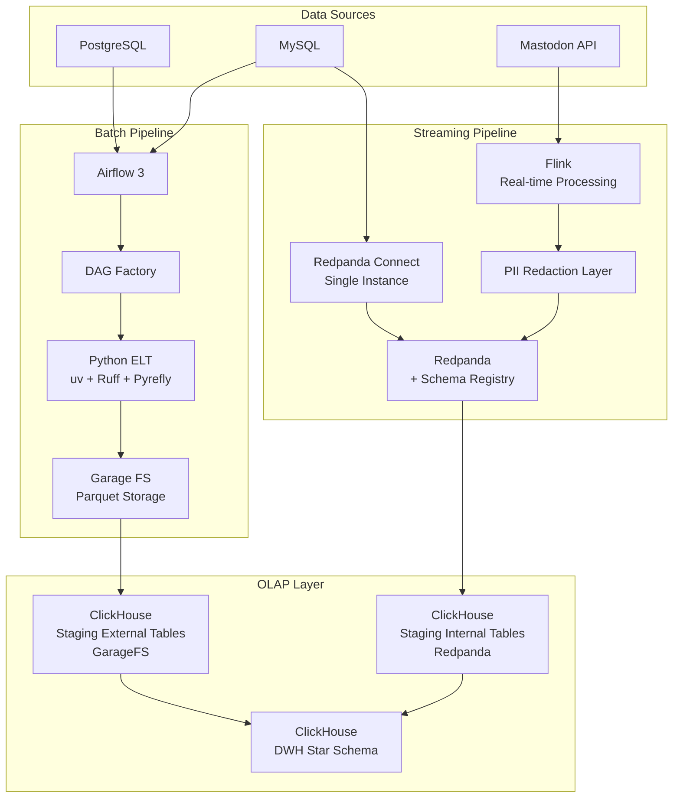
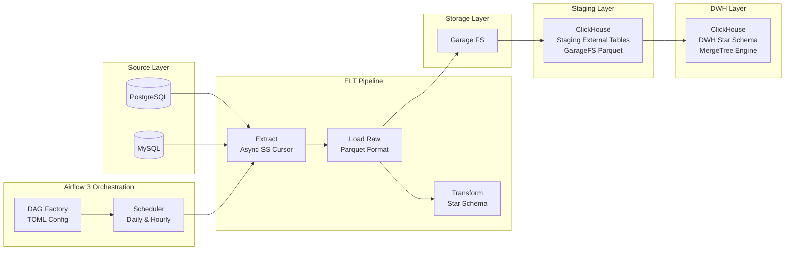
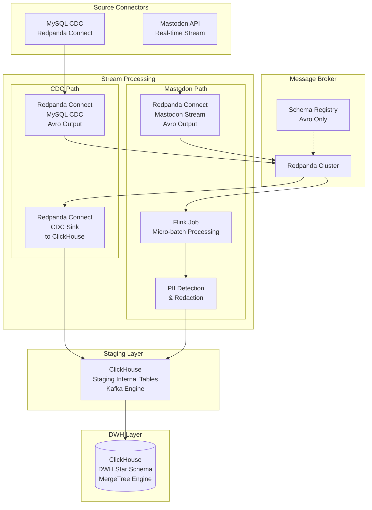

# Ultimate Data Pipeline - Detailed Architecture Design

## System Architecture Overview



---

## Batch Processing Architecture



### Batch Processing Details

**Orchestration:**
- Airflow 3 with DAG factory pattern
- Configuration-driven DAG generation from TOML files
- Daily (full load) and hourly (incremental) schedules

**Extraction:**
- Async source connections using server-side cursors
- MySQL and PostgreSQL support
- Chunked processing for 8GB RAM constraint
- Batch mode (no streaming when processing batches)

**Load:**
- Parquet format for efficient storage
- Garage FS as S3-compatible object storage
- Partition strategy: date-based (year/month/day)

**Transform:**
- ELT pattern: raw data loaded first, then transformed
- ClickHouse **staging external tables** pointing to GarageFS Parquet files (S3 engine)
- Star schema modeling with fact and dimension tables
- Materialized views or INSERT SELECT from staging external tables to DWH internal tables

---

## Streaming Architecture



### Streaming Details

**MySQL CDC (Change Data Capture):**
- Redpanda Connect as CDC source connector
- Reads MySQL binlog for real-time change events
- **Avro serialization** with Schema Registry
- Publishes to Redpanda topics (partitioned by table)
- Sink to ClickHouse **staging internal tables** (Kafka engine)

**Mastodon Real-time Processing:**
- Redpanda Connect consumes Mastodon streaming API
- **Avro serialization** with Schema Registry
- Publishes raw events to Redpanda topics
- Flink consumes from Redpanda for **micro-batch processing**
- Real-time PII detection and redaction
- NER/Regex-based PII identification
- Hashed, masked, or tokenized PII fields
- Output to staging internal tables

**Message Broker:**
- Redpanda with Schema Registry
- **Avro only** for schema enforcement
- Schema evolution with backward compatibility
- Kafka API compatible

**Staging to DWH:**
- Both CDC and Mastodon data land in **internal staging tables** using ClickHouse Kafka engine
- Materialized views consume from staging tables
- Data transformed and written to DWH star schema tables

---

## Technology Stack

| Layer | Technology | Version | Purpose |
|-------|-----------|---------|---------|
| **Language** | Python | 3.12+ | Core development |
| **Package Manager** | uv | Latest | Fast dependency management |
| **Linting** | Ruff | Latest | Code formatting & linting |
| **Type Checking** | Pyrefly | Latest | Static type analysis |
| **Container** | Docker + Compose | Latest | Infrastructure |
| **Orchestration** | Airflow 3 | Latest | Batch workflow management |
| **Message Broker** | Redpanda | v25.3.7 | Streaming platform |
| **Stream Processing** | Apache Flink | v1.20.1 | Real-time processing |
| **CDC** | Redpanda Connect | v4.53.0 | MySQL change data capture |
| **OLAP** | ClickHouse | v25.4 | Analytics database |
| **Object Storage** | Garage | Latest | S3-compatible storage |
| **Configuration** | TOML | - | Config management |

---

## Configuration Management

**Configuration Hierarchy:**
- `config.base.toml` - Environment-agnostic defaults
- `config.dev.toml` / `config.prod.toml` - Environment overrides
- `.env` file for secrets (local development, no external secret manager)
- Merged at runtime using Pydantic models

**Connection Configuration:**
- `connections.toml` for database and service connections
- Separate sections for postgresql, mysql, clickhouse, redpanda
- Environment variable references for credentials

---

## Memory & Resource Constraints

**Constraints:**
- Maximum 8GB RAM for personal PC deployment
- Single case execution (no parallel processing)
- Batch XOR Streaming (never both simultaneously)

**Batch Mode Optimization:**
- Server-side cursors for database streaming
- Fixed buffer size chunked processing
- Write to disk (Garage FS) before memory cleanup
- No in-memory aggregation for large datasets

**Streaming Mode Optimization:**
- Event-based processing with no buffering
- Time-based window operators
- RocksDB backend for Flink state management
- Minimal memory footprint per event

---

## Security & Data Privacy

**PII Handling:**
1. **Detection:** Email/phone patterns (Regex), Named entities (NER), Custom rules
2. **Redaction:** SHA-256 hashing for consistency, Masking (***REDACTED***), Tokenization (reversible), Field removal
3. **Application:** All Mastodon streams processed through PII layer before storage

**Security Layers:**
- TLS 1.3 for all connections
- Internal Docker network isolation
- Database authentication with username/password
- API keys for service-to-service communication
- Role-based access control (RBAC)
- Encryption at rest and in transit
- Audit logs for all data access

---

## Deployment

**Environments:**
- **Development:** Docker Compose locally with mock data
- **CI/CD:** Automated tests (pytest), linting (Ruff + Pyrefly), Docker image builds
- **Production:** Docker Compose with real data, backup strategy for ClickHouse and Garage

**Platform Compatibility:**
- Linux native
- Windows WSL2
- macOS ARM (Apple Silicon)

---

## Directory Structure

```
ultimate-data-pipeline/
├── config/
│   ├── base.toml              # Base configurationOka
│   ├── dev.toml               # Development overrides
│   ├── prod.toml              # Production overrides
│   └── connections.toml       # Database & service connections
│
├── batch/                     # Batch Pipeline (Airflow)
│   ├── dags/
│   │   ├── factory/
│   │   │   └── dag_generator.py
│   │   └── definitions/
│   │       └── *.toml         # DAG definitions in TOML
│   └── src/
│       ├── extractors/        # Source DB extractors
│       ├── loaders/           # Parquet loaders to GarageFS
│       └── transformers/      # ClickHouse transformations
│
├── streaming/                 # Streaming Pipeline (Flink + Redpanda)
│   ├── flink_jobs/
│   │   ├── mastodon_stream/   # Mastodon real-time job
│   │   └── shared/            # Shared Flink utilities
│   ├── connectors/
│   │   ├── redpanda_connect/  # CDC connector configs
│   │   └── clickhouse_sinks/  # ClickHouse sink configs
│   └── pii/
│       ├── detection/         # PII detection rules
│       └── redaction/         # Redaction strategies
│
├── src/                       # Shared Code
│   ├── common/
│   │   ├── config.py          # Config loader (Pydantic)
│   │   ├── models.py          # Data models
│   │   └── utils.py           # Utilities
│   └── clickhouse/
│       ├── schemas/           # DDL scripts
│       │   ├── staging/       # Staging tables (external + internal)
│       │   └── dwh/           # Star schema tables
│       └── migrations/        # Schema migrations
│
├── docker/
│   ├── Dockerfile.airflow
│   ├── Dockerfile.flink
│   └── docker-compose.yml
│
├── tests/
│   ├── unit/
│   └── integration/
│
├── .env                       # Local secrets (gitignored)
├── pyproject.toml
├── uv.lock
└── README.md
```

## What this Project Don't Cover but must have in production
- Observability of infra and streaming engine
- Secret manager i.e Hashicorp
- JWT Auth for Airflow and else
- Data Visualization / Dashboard Engine i.e Metabase

---

*Document Version: 1.3*
*Updated: 2026-02-26*
*Changes: MySQL CDC source, Avro-only serialization, Mastodon via Redpanda Connect to Flink micro-batch*
